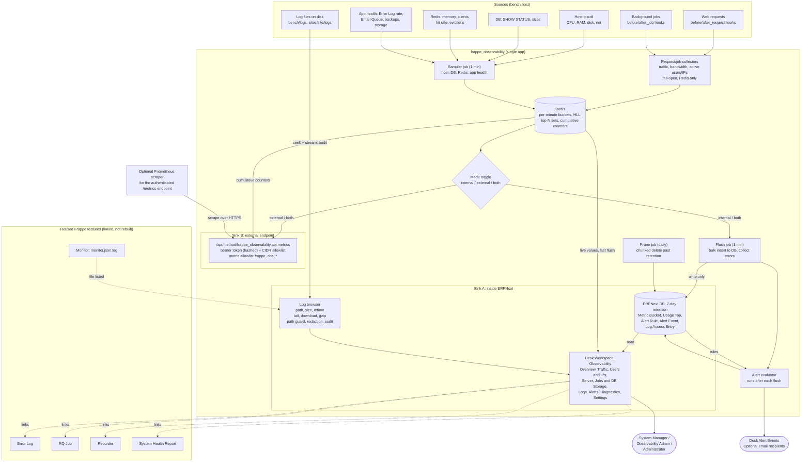

# Frappe Observability (`frappe_observability`)

Target: current upstream Frappe Framework and ERPNext `develop` branches. The upstream repositories currently identify `develop` as their default branch. Frappe Framework's current `develop` metadata requires Python `>=3.14,<3.15`; this app declares the corresponding Frappe 17 development dependency range. Database: MariaDB. Deployment: self-hosted bench.

Status: expanded implementation prepared for pull-request review. **Not production validated:** a live Frappe/ERPNext bench is not available in this build environment. Unit/static tests are run before publishing; installation, scheduler operation, permissions and load overhead still need validation on a bench.

The complete monitoring interface is inside this Frappe app's Desk. There is no separate Grafana service or Grafana dashboard package. Prometheus export is an optional integration only.

## Implementation status

The app includes request and background-job collection into Redis; minute host, MariaDB, cache Redis, RQ Redis, queue and Error Log/Email Queue samples; hourly database-table, backup, file-storage and log-directory scans; bulk/idempotent database flushing; retention pruning; a single multi-tab Desk dashboard using Frappe Charts; top-usage summaries; editable seeded Desk Alert Events with optional email notifications; and the audited read-only log browser. IPs are masked by default, user/IP identifiers are excluded from metric labels, and log path guards reject unsafe paths.

The dashboard has in-app tabs for Overview, Traffic, Users & IPs, Server, Jobs & DB, Storage, Logs, Alerts, Diagnostics and Settings. In `external` mode it shows live Redis values without writing DB history. The current upstream Frappe `develop` tree does not provide a stable failed-login-attempt DocType or hook, so the app does not fabricate a failed-login count from generic error messages. Installation/migration, streaming downloads, mail delivery, multi-site isolation, actual chart rendering and performance/security acceptance criteria still require live-bench verification.

## Install

After this reviewed local working tree has been published to the app repository's `main` branch, install it on a bench running the matching current Frappe/ERPNext `develop` stack:

```sh
bench get-app https://github.com/coffeeinit/frappe_observability --branch main
bench --site <site> install-app frappe_observability
bench --site <site> migrate
bench --site <site> enable-scheduler
bench restart
```

Configure **Observability Settings** after installation. Prometheus export is disabled until the `external` or `both` mode and metric allowlist are configured. An administrator can rotate the bearer token once through `frappe_observability.api.rotate_export_token`; copy the returned token, because only its SHA-256 digest is saved. Initial supported metrics are `frappe_obs_requests_total`, `frappe_obs_request_errors_total`, `frappe_obs_request_bytes_in_total`, `frappe_obs_request_bytes_out_total`, `frappe_obs_jobs_total`, `frappe_obs_job_failures_total`, and `frappe_obs_job_duration_milliseconds_total`.

## 1. Introduction
1.1 **Purpose.** A complete in-Desk metrics system, plus a log-file browser, for self-hosted ERPNext sites that have no monitoring today.
1.2 **Scope (in).** Usage, traffic, bandwidth, active users and IPs, host, DB, Redis, jobs, backup and storage metrics; alerts; log file browser; optional Prometheus export.
1.3 **Out of scope.** Log aggregation or search across hosts (Loki, ELK), log shipping, distributed tracing (Tempo, OTLP), alerting when ERPNext itself is down, Frappe Cloud, PostgreSQL, log delete/edit.
1.4 **Reuse (not rebuilt).** Error Log, RQ Job, Recorder, System Health Report, Monitor (`monitor.json.log`). The app links to them.

## 2. Overall description
2.1 **One app, one Desk experience.** Collectors write to Redis. Mode `internal` | `external` | `both` controls database history and optional Prometheus export. The app's own Desk page uses Frappe Charts; there is no separate Grafana service or dashboard package.
2.2 **Users.** System Manager (site data, site logs), Observability Admin (new role), Administrator (bench-level host metrics and bench logs), Prometheus scraper (token, `/metrics` only).
2.3 **Constraints.** No per-sample DocType inserts via `doc.insert()`. No DB writes in the request path. Compatibility follows the current upstream Frappe/ERPNext `develop` pair; a release should record tested commit SHAs because the branches move.
2.4 **Assumptions.** One bench host in v1. Scheduler enabled. Redis cache and queue reachable. The bench user can read `logs/` and `sites/*/logs/`.

### 2.5 Architecture diagram



## 3. Functional requirements

### 3.1 Collection
- FR-C1 Per request, record: site, normalized endpoint, status class, duration, bytes in and out, user, IP. Redis only.
- FR-C2 Latency histogram, buckets in ms: 5, 10, 25, 50, 100, 250, 500, 1000, 2500, 5000+.
- FR-C3 Active users and active IPs per minute and per hour using HyperLogLog (counts only).
- FR-C4 Top 50 users, IPs and endpoints per hour (sorted set).
- FR-C5 Jobs: duration and failures per method, queue depth per queue, failed-job count, scheduler last tick and lag.
- FR-C6 Host: CPU %, load, RAM, swap, disk used/free per mount, disk IO, network bytes in/out.
- FR-C7 DB: connections vs max, threads running, slow-query count, buffer-pool hit ratio, DB size, top 10 tables by size (hourly), long-running query count.
- FR-C8 Redis (cache and queue): memory vs maxmemory, clients, hit rate, evictions.
- FR-C9 App health: Error Log rows/min, Email Queue pending/error counts, last backup age/size per site, and public/private file storage size (hourly). Failed-login counts are not fabricated: current upstream Frappe has no stable core login-attempt DocType or failure hook.
- FR-C10 Fail-open: a collector exception never affects the request or job. Collector errors are counted and shown.
- FR-C11 Labels limited to site, host, normalized endpoint (top 50 then `other`), queue, status class. User and IP are never metric labels.

### 3.2 Storage
- FR-S1 Redis holds per-minute buckets and cumulative counters.
- FR-S2 `flush` (every minute) bulk-inserts into `Metric Bucket` and `Usage Top` via `frappe.db.bulk_insert`. No versioning or timeline.
- FR-S3 Retention default 7 days, configurable 1–30. `prune` is a separate daily job using chunked deletes (`LIMIT` loop). Flush does not prune.
- FR-S4 In `external` mode the DB flush is skipped. Cumulative Redis counters still run.
- FR-S5 Show "last flush" and collector-error count on the workspace.

### 3.3 Desk workspace (single place)
- FR-U1 One **Observability** Desk page with in-app tabs: Overview, Traffic, Users & IPs, Server, Jobs & DB, Storage, Logs, Alerts, Diagnostics, Settings. Charts use Frappe Charts; no external dashboard service is needed.
- FR-U2 Overview Number Cards: req/min, error %, p95, active users, active IPs, bandwidth, CPU, RAM, disk, queue depth, backup age, last flush.
- FR-U3 Time ranges 15m, 1h, 6h, 24h, 7d. Every Frappe site is isolated automatically; v1 assumes one bench host and therefore has no additional site/host selector.
- FR-U4 Diagnostics page links to Error Log, RQ Job, Recorder, System Health Report.
- FR-U5 Bench-level pages (Server, bench logs) require Administrator or the bench-level flag.
- FR-U6 In `external` mode the same Desk page shows live values from Redis; the database history sink is disabled. There is no Grafana dependency.

### 3.4 Log file browser
- FR-L1 Discover files in `<bench>/logs/` and `<bench>/sites/<site>/logs/`. Extra roots can be added in Settings by an admin.
- FR-L2 One list view. Columns: name, **absolute path**, scope (bench/site), **size (human and bytes)**, modified time, compressed/rotated flag. Totals: log directory size, disk free.
- FR-L3 Size is visible before any action. Downloads above a threshold (default 50 MB) require confirmation.
- FR-L4 Actions per file: View tail, Download, Download gzip, Copy path. All on the row.
- FR-L5 Viewer: last N lines (default 500), max 1 MB per request, page backward by offset. Filter within the loaded chunk. Optional live follow (poll 3 s) in v1.1.
- FR-L6 Files are read by seek and streamed in 64 KB chunks. Never loaded whole into memory.
- FR-L7 Security: `realpath` must stay inside an allowed root. Symlink escape, `..`, device files and non-regular files are rejected. Name allowlist: `*.log`, `*.log.N`, `*.json.log`, `*.gz`.
- FR-L8 Every view and download is audited (user, IP, file, bytes, time) and follows retention.
- FR-L9 View applies optional redaction (Authorization, password, token, secret, cookie patterns). Raw download shows a warning that the file may contain secrets and personal data.
- FR-L10 Read-only in v1: no delete, truncate or edit.
- FR-L11 Rotation or removal during a read returns a clear error, not a crash.
- FR-L12 Alerts on log directory total size and single-file size thresholds.

### 3.5 Alerts
- FR-A1 `Alert Rule` and `Alert Event` DocTypes. Evaluated after each flush. Cooldown per rule. Acknowledge supported.
- FR-A2 Default rules: disk >85% (warn) and >95% (critical), backup older than 48 h, queue backlog, error rate, DB connections >80%, Redis memory >90%, flush stale >3 min, log directory size.
- FR-A3 Persist events in the app's Desk Alerts view and send email through the configured Frappe mail account when recipients are configured.
- FR-A4 Stated limit: no alert is possible if ERPNext is down.
- FR-A5 In `external` mode (no DB flush) the in-app evaluator still runs on the configured schedule against live Redis values. Alert rules are managed in the Frappe app.

### 3.6 External export (Sink B)
- FR-E1 Toggle in Settings (mode `external` or `both`). Endpoint `/api/method/frappe_observability.api.metrics`.
- FR-E2 Bearer token (stored hashed) plus optional CIDR allowlist. Not public by default.
- FR-E3 Prometheus text format rendered from the cumulative Redis counters (no multiprocess client needed). Not read from the DB.
- FR-E4 Metric allowlist in Settings. Prefix `frappe_obs_`.
- FR-E5 All human-facing dashboards and default alert rules ship inside this Frappe app. Prometheus export is optional; no Grafana package is shipped.

### 3.7 Settings (single DocType)
Mode, retention days, flush interval, IP storage (full or /24-masked), metric allowlist, export token and CIDRs, log roots, redaction patterns, download-confirm threshold, alert recipients.

## 4. Data
- `Observability Settings` (single).
- `Metric Bucket`: ts, metric, host, label, count, sum, max. Index (metric, ts).
- `Usage Top`: hour, dimension (user/ip/endpoint), key, requests, bytes, errors.
- `Alert Rule`, `Alert Event`, `Log Access Entry`.
- Redis: per-minute hashes, HLL keys, top-N sorted sets, cumulative counters. All keys site- or bench-prefixed with TTL.
- Expected DB size: ~0.5–1M rows per 7 days at ~100 series (to be measured).

## 5. Non-functional
- NFR-1 Added request overhead target: p95 ≤ 1 ms, one pipelined Redis round-trip. Measure before release.
- NFR-2 `flush` completes in <5 s for a typical minute. Prune never holds long locks.
- NFR-3 Settings changes take effect within 60 s without restart.
- NFR-4 IPs are personal data: masking option, admin-only top-N, audit trail.
- NFR-5 Compatibility: current upstream Frappe/ERPNext `develop` pair, with the app's `[tool.bench.frappe-dependencies]` range matching Frappe 17 development versions. Verify against pinned SHAs before release.
- NFR-6 Multi-site isolation: a site's System Manager sees only that site's data and logs.

## 6. Install and operations
1. `bench get-app https://github.com/coffeeinit/frappe_observability --branch main` on a bench using matching Frappe/ERPNext `develop` checkouts.
2. `bench --site <site> install-app frappe_observability`
3. `bench --site <site> migrate`
4. `bench restart` (production: supervisor or systemd restart)
5. `bench --site <site> enable-scheduler`, then configure Settings.

Uninstall: `bench --site <site> uninstall-app frappe_observability`. Host logrotate is a prerequisite.

## 7. Acceptance criteria (not yet verified)
- AC-1 Install, migrate and uninstall succeed on a clean bench using the targeted upstream `develop` pair.
- AC-2 Under load, request, bandwidth, active-user and active-IP figures match a reference generator within 2%.
- AC-3 Rows older than retention are removed within 24 h. Table size stays bounded.
- AC-4 Log browser lists files with correct path and size. Tail and download work on a >1 GB file with flat memory use.
- AC-5 Path traversal and symlink-escape attempts are rejected and audited.
- AC-6 A site System Manager cannot see bench logs or another site's data.
- AC-7 Stopping the scheduler raises the "flush stale" state on the workspace.
- AC-8 `/metrics` rejects a missing or bad token and serves valid Prometheus text with the token.
- AC-9 Overhead measured and reported against NFR-1.
- AC-10 In `external` mode no rows are written to `Metric Bucket`; `/metrics` still serves current values.

## 8. Open items
Multi-host sampler process, 5-minute downsampling after 24 h, live-follow, PostgreSQL support, optional log truncate/rotate action, optional Loki/Tempo integration (post-v1).
